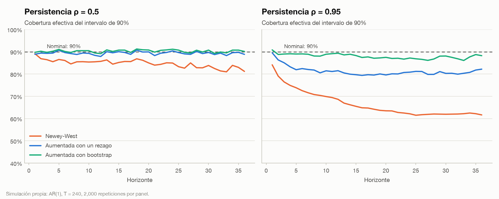
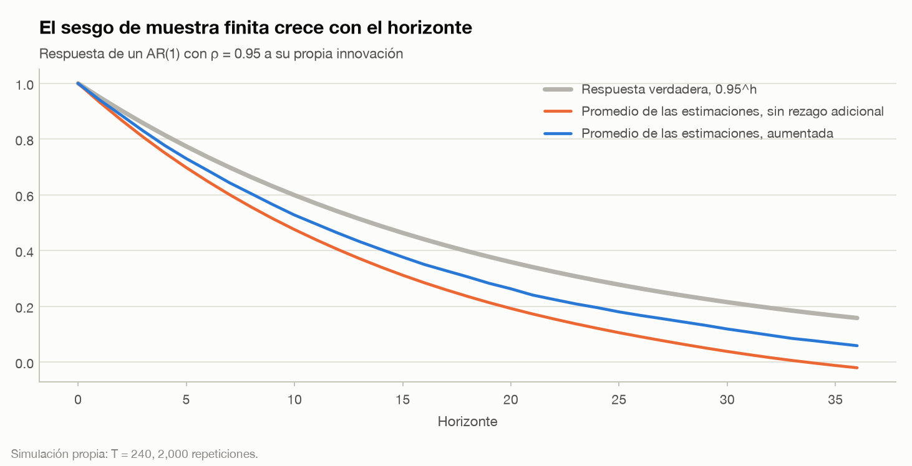
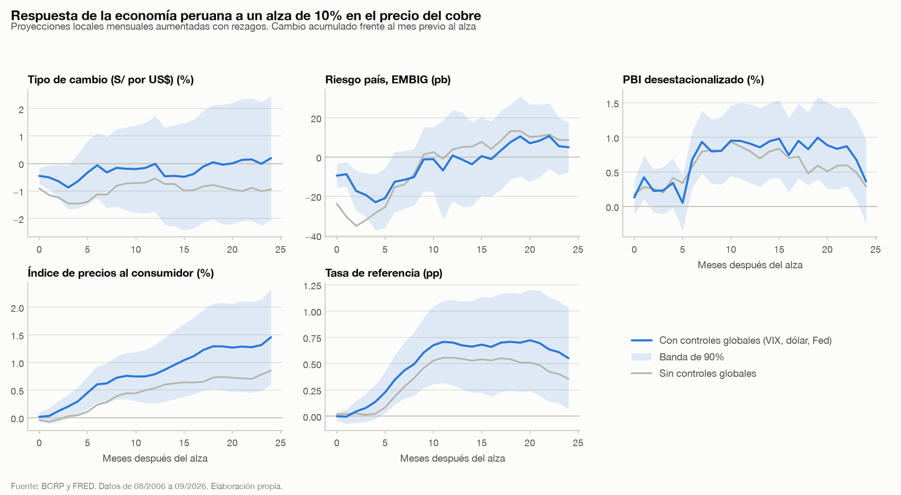

# Proyecciones locales desde cero

[](https://github.com/paolojoveal/proyecciones-locales/actions/workflows/pruebas.yml)

**¿Cuánto se puede confiar en las bandas de una función impulso-respuesta?**

Las proyecciones locales (Jordà, 2005) son el método más usado hoy en macroeconomía aplicada para estimar el efecto dinámico de un choque. Este repositorio las implementa con `numpy`, mide por simulación si sus intervalos de confianza cumplen lo que prometen y las aplica a una pregunta sobre la economía peruana.



## 1. El estimador

Para cada horizonte *h* se estima por MCO una regresión distinta, y la función impulso-respuesta es la secuencia de coeficientes del impulso:

`y_{t+h} = a_h + b_h·x_t + controles + u_{t+h}`

[`lp/estimador.py`](lp/estimador.py) ofrece dos formas de inferencia:

| Método | Qué hace |
|---|---|
| `"hac"` | Errores de Newey-West con truncamiento en *h*. Es la práctica tradicional: el error de la regresión en *h* es una media móvil de orden *h* |
| `"aumentada"` | Agrega un rezago más de cada variable y usa errores robustos a heterocedasticidad, sin corrección por autocorrelación (Montiel Olea y Plagborg-Møller, 2021) |

```python
from lp.estimador import proyeccion_local

r = proyeccion_local(y, x, controles=w, horizontes=24, rezagos=6, metodo="aumentada", acumulada=True)
inferior, superior = r.banda(0.90)
```

También admite respuestas acumuladas (para variables en logaritmos) y excluir periodos atípicos, como los meses de cierre de 2020, tanto de la variable dependiente como de los rezagos.

## 2. ¿Cubren los intervalos lo que dicen cubrir?

Un intervalo de 90% bien construido contiene el valor verdadero cerca de 90% de las veces. Para comprobarlo hace falta conocer ese valor, así que se simula: un AR(1) cuya respuesta verdadera es ρ^h, 240 observaciones (20 años de datos mensuales) y 2 000 muestras por caso ([`lp/montecarlo.py`](lp/montecarlo.py)).

| Horizonte | ρ = 0.5, Newey-West | ρ = 0.5, aumentada | ρ = 0.95, Newey-West | ρ = 0.95, aumentada |
|---|---|---|---|---|
| 1 | 90% | 90% | 83% | 89% |
| 6 | 86% | 89% | 71% | 82% |
| 12 | 87% | 90% | 66% | 80% |
| 24 | 83% | 88% | 61% | 78% |
| 36 | 81% | 89% | 60% | 81% |

- **Con persistencia moderada, la versión aumentada cumple:** cubre entre 88% y 90% en todos los horizontes. Newey-West pierde cobertura a medida que crece el horizonte y llega a 81%.
- **Con alta persistencia, Newey-West falla por mucho:** un intervalo «de 90%» cubre el valor verdadero 60% de las veces a tres años. La mayoría de las series macroeconómicas son así de persistentes.
- **La versión aumentada mejora, pero tampoco llega a 90%** con ρ = 0.95: se queda cerca de 80%. La razón está en el gráfico siguiente.



Con series persistentes y muestras de este tamaño, las proyecciones locales subestiman la respuesta, y el sesgo crece con el horizonte (Herbst y Johannsen, 2024). A 24 meses la respuesta verdadera es 0.29 y el promedio de las estimaciones es 0.20 con la versión aumentada y 0.12 sin el rezago adicional. Un intervalo centrado en un estimador sesgado cubre menos de lo que anuncia, por bien calculada que esté su amplitud.

**Qué me llevo para el trabajo aplicado:** usar la versión aumentada, desconfiar de la precisión aparente en horizontes largos y recordar que el sesgo empuja las respuestas hacia cero.

## 3. Aplicación: después de un alza del precio del cobre

El cobre es el principal producto de exportación del Perú. ¿Qué pasa en la economía en los dos años que siguen a un alza de su precio?



Proyecciones locales mensuales de agosto de 2006 a septiembre de 2026 (242 meses), con seis rezagos y, en la especificación principal, el VIX, el dólar global y la tasa de la Fed como controles. Respuestas a un alza de 10%:

| Variable | Al impacto | A 3 meses | A 12 meses | A 24 meses |
|---|---|---|---|---|
| Tipo de cambio (%) | **−0.45** | **−0.87** | −0.01 | 0.19 |
| Riesgo país, EMBIG (pb) | **−9.5** | **−19.3** | 0.8 | 5.0 |
| PBI (%) | 0.13 | 0.23 | **0.91** | 0.36 |
| Índice de precios (%) | 0.02 | 0.20 | **0.79** | **1.46** |
| Tasa de referencia (pp) | 0.00 | 0.08 | **0.70** | **0.55** |

En negrita, las respuestas cuya banda de 90% excluye el cero.

- **Primero reaccionan los mercados:** el sol se aprecia y el riesgo país cae en el mismo mes, y el efecto se disipa en medio año.
- **Después, la actividad:** el PBI sube cerca de 0.9% al año.
- **Al final, los precios y el banco central:** el nivel de precios sube de forma persistente y la tasa de referencia termina 0.7 pp más alta.
- **Controlar por las condiciones globales importa.** Sin el VIX y el dólar, la apreciación al impacto es el doble (−0.91%) y la caída del riesgo país, más del doble (−24 pb). Buena parte de lo que parece «efecto cobre» en los mercados es apetito global por riesgo, que mueve a la vez el cobre y al sol.

### Lo que este ejercicio no permite afirmar

- **Un alza del cobre no es un choque exógeno identificado.** El precio del cobre responde a la demanda mundial, que afecta al Perú por muchos otros canales, y se mueve junto con el petróleo y los alimentos, que entran directo al IPC. La respuesta de los precios mezcla todo eso. Lo estimado es qué suele pasar después de un alza del cobre, no el efecto causal del cobre.
- Los tres controles globales absorben parte del problema, no todo.
- Por el sesgo documentado arriba, las respuestas a horizontes largos probablemente están subestimadas.
- La muestra contiene dos crisis globales. Para el PBI se excluyen los meses de cierre de 2020; para las demás variables no.

## Cómo correrlo

```bash
git clone https://github.com/paolojoveal/proyecciones-locales.git
cd proyecciones-locales
python -m venv .venv && source .venv/bin/activate   # en Windows: .venv\Scripts\activate
pip install -r requirements.txt

python -m lp.montecarlo                      # simulación completa (unos minutos)
python -m lp.montecarlo --repeticiones 300   # versión rápida
python aplicacion_cobre.py                   # descarga datos del BCRP y de FRED
```

## Cómo se verifica

Las pruebas ([`tests/`](tests)) comparan el estimador con casos de respuesta conocida:

- En el horizonte cero coincide con una regresión simple.
- Las matrices de covarianzas (robusta y de Newey-West) son iguales a las de `statsmodels` con ocho decimales.
- En muestras grandes recupera la respuesta de un AR(1) y la de un modelo con choque observado.
- La respuesta acumulada de un paseo aleatorio a su propio choque vale uno.
- Un dato absurdo marcado para excluir no altera la estimación.

```bash
pip install -r requirements-dev.txt
pytest
```

## Estructura

```
lp/estimador.py        Proyecciones locales e inferencia
lp/montecarlo.py       Simulación de sesgo y cobertura
aplicacion_cobre.py    Aplicación a la economía peruana
datos.py               Descarga validada de series del BCRP y de FRED
resultados/            Figuras y tablas
tests/                 Pruebas automáticas
```

## Límites de la simulación

- El proceso simulado es un AR(1) univariado con errores normales. Con otros procesos las cifras cambian; el resultado teórico de Montiel Olea y Plagborg-Møller cubre los VAR en general.
- Solo se evalúan intervalos basados en la normal. El bootstrap, que ellos recomiendan para muestras pequeñas, mejora la cobertura y no está implementado.

## Referencias

- Herbst, E. y Johannsen, B. (2024). Bias in local projections. *Journal of Econometrics*, 240(1).
- Jordà, Ò. (2005). Estimation and inference of impulse responses by local projections. *American Economic Review*, 95(1).
- Montiel Olea, J. L. y Plagborg-Møller, M. (2021). Local projection inference is simpler and more robust than you think. *Econometrica*, 89(4).
- Newey, W. y West, K. (1987). A simple, positive semi-definite, heteroskedasticity and autocorrelation consistent covariance matrix. *Econometrica*, 55(3).
- Plagborg-Møller, M. y Wolf, C. (2021). Local projections and VARs estimate the same impulse responses. *Econometrica*, 89(2).
- Ramey, V. (2016). Macroeconomic shocks and their propagation. En *Handbook of Macroeconomics*, vol. 2. Elsevier.

## Sobre mí

**Paolo Jove** · Estudiante de 8.º semestre (por iniciar el 9.º) en la **Pontificia Universidad Católica del Perú (PUCP)**. Más proyectos en [portafolio-finanzas](https://github.com/paolojoveal/portafolio-finanzas) y [auditoria-analitica-ventas](https://github.com/paolojoveal/auditoria-analitica-ventas).

[LinkedIn](https://www.linkedin.com/in/paolo-jove-085647127)

---

<sub>© 2026 Paolo Jove. Todos los derechos reservados.</sub>
